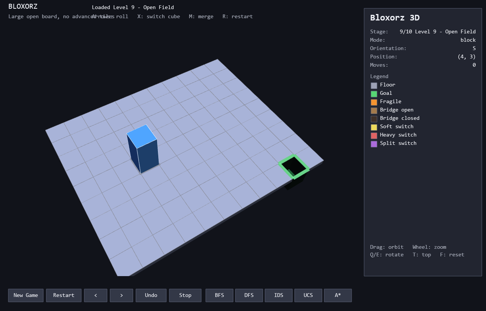
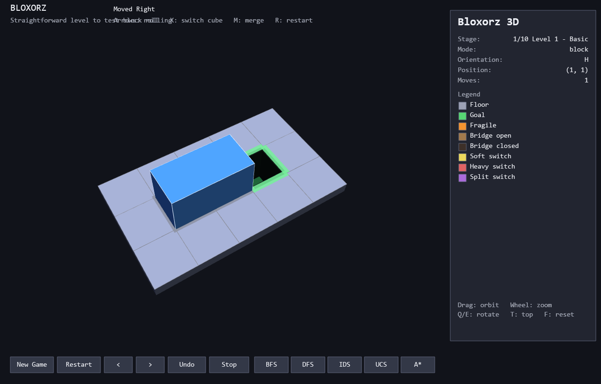
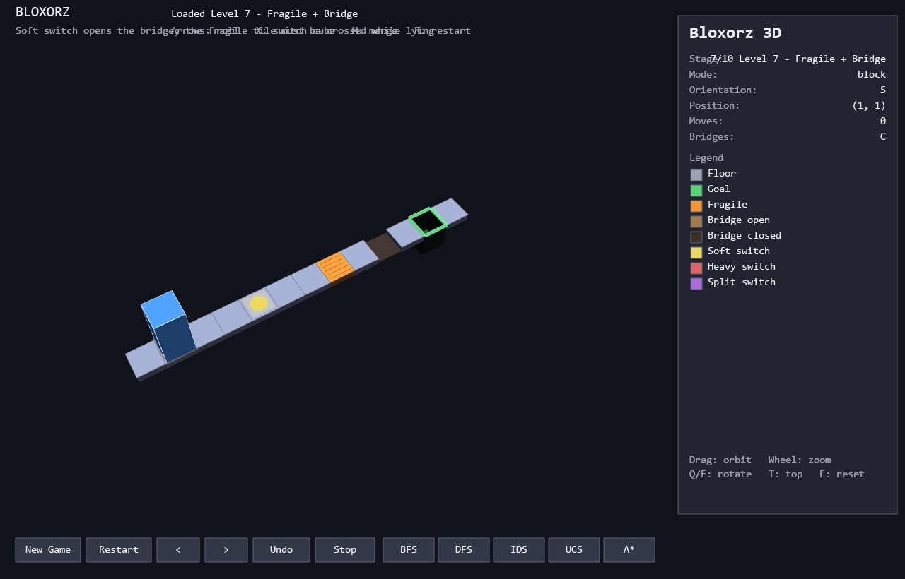

# Bloxorz Solver — CSC14003 Project 1

A playable **Bloxorz** implementation (core mechanics + advanced tiles) together
with four families of search algorithms — **BFS, DFS, IDS, UCS, A\*** — built
from scratch, plus an experiment harness that measures search time, peak memory,
expanded nodes and solution length. The board is rendered in **real 3D** with
PyOpenGL (lighting, shadows, rolling animation, orbit camera).

## Requirements

* Python 3.10+ (tested on 3.11, Windows)
* `pip install -r requirements.txt` (pygame + PyOpenGL for the 3D GUI, matplotlib
  for the charts, pytest for the tests)
* A GPU/driver with OpenGL 2.0+ (any modern machine)

Step-by-step install / run / build instructions (virtualenv, packaging the
submission, troubleshooting): see **[BUILD_AND_RUN.md](BUILD_AND_RUN.md)**.

## Run

```bash
python main.py                      # 3D GUI (default)
python main.py --list               # list the 10 stages
python main.py --solve A* --stage 7 # solve stage 7 from the terminal
python main.py --solve UCS --cost uniform -v   # print the move sequence
python main.py --all                # every solver on every stage
```

### GUI controls

| Input | Action |
|---|---|
| Arrow keys / WASD | Roll the block |
| `X` | Switch the controlled cube (split mode) |
| `M` | Merge two adjacent cubes |
| `R` | Restart the stage |
| `Esc` | Quit |
| Left / right drag | Orbit the 3D camera |
| Mouse wheel / `+` `-` | Zoom |
| `Q` / `E` | Rotate the camera |
| `PageUp` / `PageDown` | Camera pitch |
| `T` | Top-down view |
| `F` | Reset the camera |
| Buttons | New Game, Restart, `<` `>` stage, Undo, Stop, **BFS / DFS / IDS / UCS / A\*** |

The right-hand panel shows the current state, the legend, and — after a solver
finishes — the full measurement set (solution length, path cost, expanded nodes,
search time, peak memory, max frontier). Solver results are replayed on the
board with a progress bar; the block rolls through a real 3D animation.



## 3D view

`gui_gl.py` renders everything with the **fixed-function OpenGL** pipeline (no
shaders) inside a single pygame window (`OPENGL | DOUBLEBUF`, 4× MSAA when the
driver supports it):

* **Scene** — every cell is a 1×1 box with per-face normals; the goal is a
  recessed cavity with a green rim, fragile tiles get hatch marks, switches are
  drawn as flat shapes (disc / cross / brackets) and a closed bridge sinks below
  the floor plane. The board is centred at the origin and lit by two directional
  lights (world space) with `GL_COLOR_MATERIAL`.
* **Camera** — `gluPerspective` + `gluLookAt`, orbit angles and distance stored
  as `(yaw, pitch, dist)`; drag/wheel/`Q E PageUp PageDown T F` modify them.
* **Roll animation** — a roll rotates the box 90° about the contact edge
  (pivot = bottom edge in the direction of the move, smoothstep easing over
  0.15 s). The replay loop only advances a step while no animation is running,
  and the block sinks into the hole once the goal is reached.
* **UI overlay** — after the 3D pass an ortho pass draws the panel, buttons and
  text; strings are rendered by pygame fonts and uploaded to a small GL texture
  cache.
* **Screenshots / headless checks** — set `BLOXORZ_GL_FRAMES` to quit after N
  frames and `BLOXORZ_GL_SHOT=path.png` to save a screenshot (this is how the
  images in `screenshots/` were produced).





## Project layout

```
Source/
├── main.py                 entry point (GUI + CLI)
├── gui_gl.py               PyOpenGL 3D GUI (board, block, camera, overlay UI)
├── requirements.txt
├── README.md                what this project is and how it works
├── BUILD_AND_RUN.md         install / run / test / package (VN)
├── bloxorz/
│   ├── stage.py            level format: JSON/ASCII loading + validation
│   ├── engine.py           state representation + transition model + rules
│   ├── search.py           BFS / DFS / IDS / UCS / A* + metrics
│   └── __init__.py
├── stages/                 10 stages in 4 difficulty groups
├── tests/                  pytest suite (unit + all solvers on all stages)
├── screenshots/            README figures (generated with BLOXORZ_GL_SHOT)
└── experiments/
    ├── run_experiments.py  produces results.csv
    ├── make_charts.py      produces charts/*.png + charts/summary.md
    └── charts/             tables and figures for the report
```

## Game model

**State** (`bloxorz/engine.py`, `GameState` — hashable, used directly as the
search key):

| Field | Meaning |
|---|---|
| `mode` | `"block"` (1×1×2) or `"split"` (two unit cubes) |
| `orient` | `S` standing, `H` lying horizontally, `V` lying vertically |
| `pos` | anchor cell for the block, or the pair of cells in split mode |
| `active` | which cube is controlled in split mode |
| `bridges` | state of **every** bridge (closed / open / locked) |

Because bridge configuration is part of the state, two positions with different
bridge layouts are different states — required by the brief.

**Actions:** `U D L R` rolls, `X` switches the active cube, `M` merges two
adjacent cubes. `Engine.result()` returns `None` for illegal moves (void,
out of bounds, closed bridge, standing on a fragile tile) and applies switch
effects, including split-switch teleportation.

The geometry of a move is computed once, in `Engine.landing_state()` — the
state produced *before* switch/teleport effects. Both `Engine.result()` and
the `risk` cost model are built on it, so the cost function can never
disagree with the transition model about which switches fire.

**Cost functions** (`bloxorz/search.py`): `uniform` (every action costs 1) and
`risk`, evaluated on the landing state:

| Situation | Cost |
|---|---|
| `X` (switch control, nothing moves) | 1 |
| any action that presses at least one switch | 1 |
| any other action (roll or merge) | 2 |
| landing on a fragile tile | +1 |

UCS/A\* default to `risk` so UCS is not just a renamed BFS; every cost is
≥ 1, which is what keeps the heuristic admissible. BFS/DFS/IDS are
move-optimal and always report the `uniform` model.

**Heuristic:** pre-computed 4-connected shortest-path distance to the goal over
the relaxed grid (bridges/fragile/switches ignored), then `h(s) = min over
occupied cells of D(cell, goal)`. It is admissible (one action can decrease the
minimum distance by at most 1) and consistent, and admissible w.r.t. both cost
models because every action costs ≥ 1.

## Stage format

```json
{
  "name": "Level 4 - Soft Switch",
  "group": "C - Switches",
  "description": "...",
  "map": ["............", "#S###s###0G#", "............"],
  "start": [1, 1],
  "bridges": ["closed"],
  "switches": [
    {"kind": "soft", "mode": "toggle", "cells": [[1, 5]], "bridges": [0]}
  ]
}
```

Map legend: `#` floor, `.`/space void, `G` goal, `F` fragile, `0-9` bridge,
`s` soft switch, `x` heavy switch, `t` split switch, `S` start.

## Tests

```bash
python -m pytest tests/ -q
```

98 tests: unit tests for the orientation/transition table and advanced tiles,
every solver replayed end-to-end on every stage (the replay must reach the
goal), BFS-vs-IDS optimality, empirical admissibility/consistency of the
heuristic (`tests/test_heuristic.py`), the cost models
(`tests/test_cost_models.py`: switch-landing prices, every transition ≥ 1,
UCS and A\* agree on the optimal risk cost, IDS stays bounded), and input
validation for the stage loader.

## Experiments

```bash
python experiments/run_experiments.py            # -> experiments/results.csv
python experiments/run_experiments.py --runs 5   # more repeats (median time)
python experiments/run_experiments.py --skip-ids # skip IDS in the sweep
python experiments/make_charts.py                # -> charts/*.png + summary.md
```

Measures, for every (stage, algorithm): search time (median of `--runs`
repeats, default 3), peak memory (`tracemalloc`), expanded nodes, solution
length and path cost.
